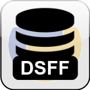

# DataSet File Format

<p align="center"></p>

**DSFF** (DataSet File Format) is a tiny library relying on [`openpyxl`](https://pypi.org/project/openpyxl) that stores a dataset with its features, for use with machine learning, in an XSLX file whose structure is enforced. It makes it easy to store, edit and exchange a dataset.

[](https://pypi.python.org/pypi/dsff/)
[](https://pypi.python.org/pypi/dsff/)
[](https://github.com/packing-box/python-dsff/actions/workflows/python-package.yml)
[](https://github.com/packing-box/python-dsff/actions/workflows/security.yml)
[](https://pypi.python.org/pypi/dsff/)

It is used with the [Packing Box](https://github.com/packing-box/docker-packing-box) to export datasets in a convenient format.

-----

## Features

- A single `.dsff` file holds the data, the description of each feature and the metadata of the dataset.
- The file is a regular XSLX workbook: it opens in any spreadsheet editor.
- Conversion from and to [ARFF](https://www.cs.waikato.ac.nz/ml/weka/arff.html) (for [Weka](https://www.cs.waikato.ac.nz/ml/weka)), [CSV](https://www.rfc-editor.org/rfc/rfc4180), [SQLite](https://www.sqlite.org/fileformat.html) databases and [FilelessDataset](https://docker-packing-box.readthedocs.io/en/latest/usage/datasets.html) folders from the Packing Box.
- With [`pyarrow`](https://arrow.apache.org/docs/python/index.html), conversion from and to the [Apache Arrow](https://arrow.apache.org/) formats Feather, ORC and Parquet.

## Quick start

```console
$ pip install dsff
```

```python
>>> import dsff
>>> with dsff.DSFF("my-dataset", "w") as f:
...     f.write(data=[["name", "size", "label"], ["a.exe", 1024, "upx"], ["b.exe", 2048, "?"]],
...             features={'size': "size of the executable"},
...             metadata={'source': "my lab"})
...     f.to_csv()  # creates ./my-dataset.csv
...
# while leaving the context, ./my-dataset.dsff is created
```

See [Installation](installation.md) and [Usage](usage.md) to go further.
